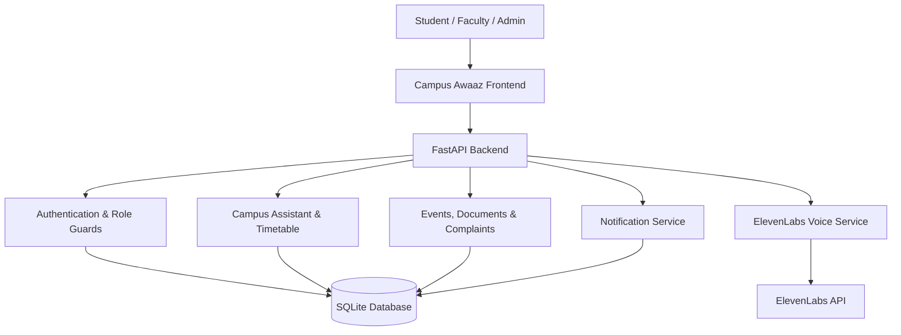

# 🎙️ Campus Awaaz
### Your Campus. Your Voice. Your Awaaz.

**An AI-powered, multilingual campus voice assistant that helps students access campus information, stay informed, and raise complaints through natural voice conversations.**

[](https://campus-awaaz-73cp61x9t-mdhamidazams-projects.vercel.app/)
[](https://github.com/MdHamidAzam/Campus-Awaaz)
[](https://www.python.org/)
[](https://fastapi.tiangolo.com/)
[](https://www.sqlite.org/)

---

## 🌟 Overview

Campus Awaaz is a voice-first AI assistant designed to make campus information and student support more accessible.

Students often struggle to find information about class schedules, campus events, library resources, college documents, and other important updates. Reporting a problem can also involve unnecessary effort and uncertainty.

**Campus Awaaz brings these interactions into one place.** Students can ask questions using their voice, receive spoken responses, access campus information, and submit complaints—including anonymous complaints where supported.

Built around ElevenLabs voice technology and a FastAPI backend, the project combines conversational interaction with structured campus data and role-based dashboards.

> **Our vision:** Make campus services as easy to access as having a conversation.

## ✨ Key Features

### 🎤 1. AI Voice Assistant
- Voice-based interaction powered by ElevenLabs speech technology.
- Speech-to-text and text-to-speech integration.
- English and Hindi language selection for more accurate voice interaction.
- Spoken assistant responses with a stop-speaking control.
- Campus-focused question answering using available project data.

### 🏫 2. Campus Information Hub
- Access timetable and class-related information.
- Explore campus events and announcements.
- Retrieve relevant college documents.
- Get information about campus facilities and rooms.
- Use a centralized assistant instead of navigating multiple information sources.

### 📢 3. Student Complaint System
- Submit complaints through the campus support workflow.
- Support for anonymous complaint submission where enabled.
- Store complaints in the application database.
- Organize complaint information for authorized administrative review.

### 🛡️ 4. Role-Based Dashboards
- **Student:** Ask questions, access campus information, and submit complaints.
- **Faculty:** Access the faculty-facing functionality available in the application.
- **Admin / Management:** Manage and review administrative information, documents, and student concerns.

Access to protected functionality is controlled by the backend's authentication and authorization logic.

### 🔔 5. Notifications and Class Reminders
- Scheduled class reminders based on configured timetable data.
- Configurable reminder timing.
- Optional email notifications through SMTP.
- Centralized notification-related functionality.

### 🗂️ 6. Campus Knowledge Base
- Store campus information and documents.
- Support document-based information retrieval.
- Keep student-facing information separate from restricted administrative documents.
- Use demo data for the current demonstration environment.

### 🔐 7. Authentication and Security
- Password hashing.
- Session-based authentication.
- Role-based access controls.
- Login throttling.
- Protected administrative routes.
- Server-side handling of sensitive API credentials.

Security features depend on the configured deployment environment and must be reviewed before production use.

---

## 🧰 Tech Stack

| Layer | Technology |
|---|---|
| Frontend | HTML5, CSS3, JavaScript ES Modules |
| Backend | Python, FastAPI |
| ASGI Server | Uvicorn |
| Database | SQLite |
| Voice AI | ElevenLabs API |
| Authentication | Password hashing, sessions, role-based access |
| Document Processing | Python, python-docx |
| HTTP Client | HTTPX |
| Configuration | Environment variables, python-dotenv |
| Deployment | Vercel frontend deployment; backend hosting compatibility must be verified |

The frontend uses native HTML, CSS, and JavaScript modules, so a separate frontend build step is not required.

---

## 🏗️ System Architecture



### How it works

1. The user interacts with the web application.
2. The frontend sends requests to the FastAPI backend.
3. The backend validates requests and applies authentication and authorization rules where required.
4. Campus services retrieve or update relevant database records.
5. Voice requests use the ElevenLabs integration when configured.
6. The frontend presents the response and can play the assistant's spoken reply.

**Important:** ElevenLabs handles the configured speech capabilities; campus-specific answers and application workflows are implemented by Campus Awaaz.

---

## 📁 Project Structure

```text
campus-awaaz/
├── backend/
│   ├── app/
│   │   ├── main.py
│   │   ├── config.py
│   │   ├── admin_accounts.py
│   │   ├── database.py
│   │   ├── core/
│   │   │   └── security.py
│   │   ├── routers/
│   │   │   ├── auth
│   │   │   ├── assistant
│   │   │   ├── campus
│   │   │   ├── admin
│   │   │   └── voice
│   │   └── services/
│   │       ├── chat_engine
│   │       ├── timetable
│   │       ├── notifications
│   │       └── elevenlabs
│   ├── data/
│   ├── docs/
│   ├── source_docs/
│   ├── scripts/
│   ├── storage/
│   │   └── campus.db
│   ├── .env.example
│   └── requirements.txt
├── frontend/
│   ├── index.html
│   ├── css/
│   │   └── style.css
│   └── js/
│       ├── main.js
│       ├── config.js
│       ├── core/
│       ├── services/
│       └── pages/
├── requirements.txt
├── pyproject.toml
└── README.md
```

*The tree above illustrates the main modules. Individual filenames and deployment configuration may differ in the current repository.*

---

## 🚀 Getting Started

### Prerequisites

Install the following before running the project:

- Python 3.12 or a compatible version supported by the project's dependencies.
- pip.
- Git.
- An ElevenLabs API key for voice functionality.
- SMTP credentials only if email notifications are required.

### 1. Clone the repository

```bash
git clone https://github.com/MdHamidAzam/Campus-Awaaz.git
cd Campus-Awaaz
```

### 2. Create a virtual environment

**Windows — Command Prompt**

```bat
cd backend
python -m venv venv
venv\Scripts\activate
```

**Windows — PowerShell**

```powershell
cd backend
python -m venv venv
.\venv\Scripts\Activate.ps1
```

**macOS / Linux**

```bash
cd backend
python3 -m venv venv
source venv/bin/activate
```

### 3. Install dependencies

```bash
python -m pip install -r requirements.txt
```

Run this command from the `backend/` directory.

### 4. Configure environment variables

Copy the example configuration file.

**Windows**

```bat
copy .env.example .env
```

**macOS / Linux**

```bash
cp .env.example .env
```

Open `backend/.env` and configure the values supported by the project.

```dotenv
# Voice integration
ELEVENLABS_API_KEY=your_elevenlabs_api_key

# Application configuration
# Retain the supported settings from .env.example

# Optional email notifications
# Configure SMTP settings if email delivery is required
```

Use the actual variable names defined in `.env.example` for database paths, CORS, reminder timing, demo mode, and SMTP configuration.

**Never commit `.env` or real API keys, passwords, SMTP credentials, or production secrets to GitHub.**

### 5. Start the backend

From the `backend/` directory, with the virtual environment activated:

```bash
uvicorn app.main:app --reload
```

The application should start at:

- **Application:** http://localhost:8000
- **API documentation:** http://localhost:8000/docs
- **Alternative API documentation:** http://localhost:8000/redoc

The root application serves the frontend when the backend's static-file configuration is enabled.

### 6. Open Campus Awaaz

Visit:

```text
http://localhost:8000
```

Use the demo-student option on the login page when demo mode is enabled.

---

## 🗄️ Database

Campus Awaaz uses SQLite for lightweight, file-based data storage.

**Default database location:**

```text
backend/storage/campus.db
```

The database is initialized by the backend when the application starts, according to its database configuration.

### Main data areas

| Table | Purpose |
|---|---|
| `users` | User accounts and role-related information |
| `sess` | Application sessions |
| `notes` | Stored notes |
| `events` | Campus events |
| `docs` | Document records |
| `compl` | Complaint records |
| `ques` | Stored questions or related assistant data |
| `rooms` | Room-related information |
| `fired` | Reminder or notification execution records |

### Inspect database records

From the `backend/` directory:

```bash
python scripts/show_db.py
```

To inspect user records:

```bash
python scripts/show_db.py users
```

You can also open `campus.db` using [DB Browser for SQLite](https://sqlitebrowser.org/).

### Production database considerations

SQLite is convenient for demos and small deployments. However, production deployment requires a persistent disk or a suitable managed database.

On hosting platforms with ephemeral filesystems, database changes may disappear after a restart or redeployment. Configure the supported database path and persistent storage before relying on stored complaints, accounts, or other campus data.

---

## 🎙️ ElevenLabs Voice Integration

Campus Awaaz uses ElevenLabs for speech-related functionality.

### Setup

1. Create an API key in the [ElevenLabs dashboard](https://elevenlabs.io/app/settings/api-keys).
2. Add it to `backend/.env`.
3. Restart the backend.
4. Select the appropriate language in the assistant interface.
5. Test microphone access and spoken responses.

### Voice API

| Method | Endpoint | Purpose |
|---|---|---|
| POST | `/api/voice/tts` | Generate spoken assistant responses |
| POST | `/api/voice/stt` | Convert microphone audio into text |

The text-to-speech service supports configured assistant voices. Voice IDs can be configured through the supported `ELEVENLABS_VOICE_1` through `ELEVENLABS_VOICE_4` settings.

The exact request and response formats are defined by the backend implementation.

**Security:** Keep the ElevenLabs API key on the server. Do not expose it in frontend JavaScript, browser-visible configuration, or public repositories.

---

## 📧 Email Notifications

Email notifications are optional.

To enable them:

1. Configure the supported `SMTP_*` environment variables.
2. Use a valid SMTP account and an app password where required.
3. Configure `CLASS_REMINDER_MINUTES` to control how far ahead class reminders are sent.
4. Restart the backend and test delivery.

For example, with the appropriate environment variables configured:

```bash
python scripts/test_email.py your-email@example.com
```

Setting `CLASS_REMINDER_MINUTES=0` configures reminders for the scheduled class time, according to the application logic.

---

## ⚙️ Configuration Reference

| Setting | Purpose |
|---|---|
| `ELEVENLABS_API_KEY` | Enables the configured ElevenLabs integration |
| `ELEVENLABS_VOICE_1` – `ELEVENLABS_VOICE_4` | Configures assistant voice IDs |
| `DEMO_MODE` | Enables or disables demo-mode behavior |
| `CLASS_REMINDER_MINUTES` | Controls class reminder timing |
| `DATABASE_PATH` | Configures the database path where supported |
| `CORS_ORIGINS` | Configures permitted cross-origin frontend origins |
| `SMTP_*` | Configures email delivery |

Check `backend/.env.example` for the complete list of supported settings and their expected formats.

### Demo mode

Demo mode is enabled by default in the supplied configuration. It creates a demo student so reviewers can explore the student-facing experience without setting up a real student account.

Set `DEMO_MODE=0` to disable the demo behavior.

The current demonstration uses sample campus information. Do not treat demo accounts, schedules, events, or other sample records as authoritative college data.

---

## 🌐 Deployment

### Live demonstration

**[Open Campus Awaaz](https://campus-awaaz-73cp61x9t-mdhamidazams-projects.vercel.app/)**

### Frontend and backend

The frontend and backend have different deployment requirements:

- **Frontend:** Static HTML, CSS, and JavaScript.
- **Backend:** Python application running FastAPI.
- **Database:** SQLite file requiring persistent storage if data must survive restarts.
- **Voice services:** Server-side API integration with ElevenLabs.

For a separate frontend host, configure `API_BASE` in `frontend/js/config.js` to point to the deployed backend, and configure the backend's `CORS_ORIGINS` appropriately.

For production, deploy the backend to a compatible Python hosting environment, configure all required environment variables, and use persistent storage or a managed database.

**Deployment note:** The live URL is provided for demonstration. Verify that authentication, voice endpoints, API routing, and database persistence work in the deployed environment before describing the deployment as production-ready.

---

## 🔒 Security Considerations

Campus Awaaz includes authentication and role-based authorization functionality, but a public demonstration is not automatically production-secure.

Before using real college or student data:

- Store secrets in environment variables or a secret manager.
- Never commit real credentials or API keys.
- Use strong, unique administrative passwords.
- Ensure protected API endpoints enforce permissions on the server.
- Use HTTPS in production.
- Restrict CORS to trusted frontend origins.
- Configure session expiration, cookie security, and appropriate session revocation.
- Add appropriate input validation, error handling, rate limiting, and audit logging.
- Protect personal information in complaints and student records.
- Keep database backups and test the restoration process.
- Review the admin account initialization and synchronization logic before deployment.

**Privacy matters:** Anonymous complaint submission should not be described as guaranteed anonymity until identity handling, logs, and associated metadata have been verified.

---

## 🗺️ Roadmap

Potential future improvements include:

- [ ] Integration with verified, up-to-date college information.
- [ ] Improved Hindi and Hinglish conversational support.
- [ ] Real-time timetable and campus announcement synchronization.
- [ ] Complaint tracking with status updates.
- [ ] Faculty and management workflow enhancements.
- [ ] Better notification delivery and reminder reliability.
- [ ] Automated backend and API tests.
- [ ] Improved production database support.
- [ ] Accessibility improvements and responsive mobile experience.
- [ ] Deployment monitoring, logging, and operational health checks.

This roadmap describes potential improvements, not features that are already guaranteed to be implemented.

---

## 🎯 Why Campus Awaaz?

Traditional campus information systems often require students to navigate multiple pages, search documents, or contact different departments.

Campus Awaaz explores a more accessible alternative: **a conversational campus interface that connects voice interaction with structured information and student support workflows.**

The project brings together voice AI, web development, backend APIs, database management, and role-based application design in a practical campus use case.

---

## 👨‍💻 Creator

**Md Hamid Azam**

B.Tech Computer Science & Engineering (AI)

Babu Banarasi Das University, Lucknow

- GitHub: [@MdHamidAzam](https://github.com/MdHamidAzam)
- Project Repository: [Campus-Awaaz](https://github.com/MdHamidAzam/Campus-Awaaz)
- Live Demo: [Campus Awaaz](https://campus-awaaz-73cp61x9t-mdhamidazams-projects.vercel.app/)

Built as a campus-focused AI project exploring voice-first student services and accessible campus information.

---

## 🤝 Contributing

Contributions, suggestions, and bug reports are welcome.

1. Fork the repository.
2. Create a feature branch.
3. Make your changes.
4. Test the affected functionality.
5. Open a pull request describing your changes.

For major changes, open an issue first to discuss the proposed implementation.

---

## 📄 License

No license has been specified here. Add a `LICENSE` file before presenting the project as open source or granting reuse rights.

---

<p align="center">
  <strong>Campus Awaaz — Your Campus. Your Voice. Your Awaaz.</strong>
  <br />
  <sub>Making campus information more accessible, one conversation at a time.</sub>
</p>
